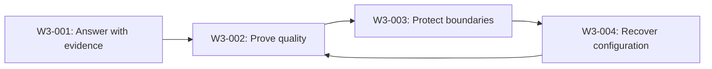
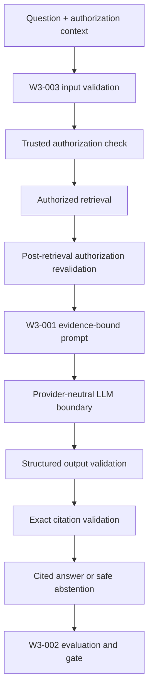
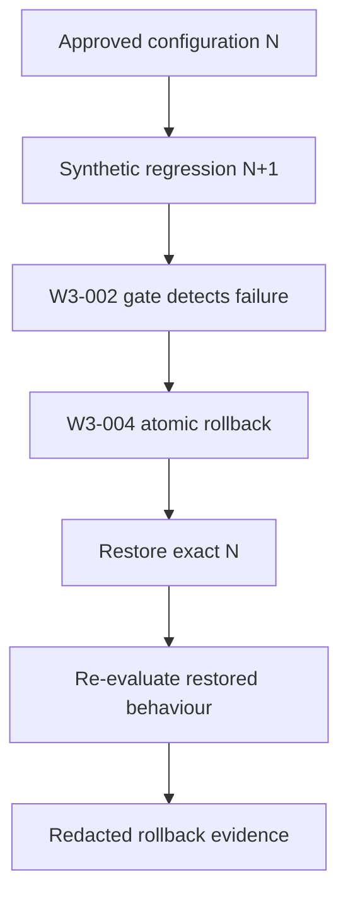

# Week 3 Implementation Learning Guide

## Document control

- Prompt/task: `W3-REVIEW-001` / W3-13
- Document classification: **Column N closed — final-approved W3-13 learning record**
- Detailed W2-11 technical authority: `docs/architecture/local-retrieval.md`
- Owner teach-back status: **PASS**
- Column N final approval: **FINAL APPROVAL AFTER OWNER TEACH-BACK — APPROVED**
- Runtime commands or tests executed by this learning task: **None**
- Tracker update responsibility: **Owner**

## W3-001 to W3-004: Answer, Prove, Protect and Recover

## 1. Document purpose and evidence status

This document explains the four Week 3 tasks in business, technical, layman and interview language. It is intended as a learning guide for an AI/Cloud Architect, not as new test evidence or production approval.

### Current status

| Task | Capability | Current evidence position |
|---|---|---|
| W3-001 | Provider-neutral cited RAG | Implemented, owner-tested and final-approved in the recorded local scope |
| W3-002 | Deterministic evaluation and release gate | Implemented, owner-tested and final-approved; first immutable baseline subsequently promoted |
| W3-003 | Deterministic guardrails and security regression | Implemented, owner-tested and final-approved in the recorded local synthetic scope |
| W3-004 | RAG configuration rollback drill | Implemented, owner-tested, rollback-drilled, documented and final-approved. The controlled N+1 regression was detected, known-good N was atomically restored, the restored evaluation passed its absolute and approved-baseline gates, four byte-identical evidence files were externally archived for 180 days, and repository-local cleanup and zero-residue verification passed. |

This distinction matters. W3-001 through W3-003 have owner-executed test evidence. W3-004 describes the approved implementation boundary and expected behaviour, but this document does not claim that its code or drill has passed.

### Week 3 in one sentence

Week 3 turns retrieval into a governed AI capability that can produce cited answers, measure whether those answers are acceptable, block predictable security failures and restore an exact known-good configuration after regression.



The return from W3-004 to W3-002 is deliberate: restoring a configuration is not enough. The restored behaviour must be evaluated again.

---

# 2. Business summary

## 2.1 The business problem

A basic RAG demonstration may retrieve a document and generate a plausible answer, but an enterprise needs stronger assurances:

- Can users see which approved sources support the answer?
- Does the system refuse to answer when evidence is missing or unauthorized?
- Can quality and security be measured consistently instead of reviewed informally?
- Can malicious or malformed input bypass controls?
- Can a bad prompt, provider, retriever or evidence configuration be reversed safely?
- Can the organization prove what happened to a reviewer, risk manager or auditor?

Week 3 addresses those questions as four connected controls.

## 2.2 Business value by implementation

### W3-001 — Trustworthy answers

W3-001 converts retrieved information into a cited answer or a safe abstention. It prevents the application from presenting unsupported model text as enterprise knowledge.

Business value:

- improves user trust by showing exact source provenance;
- reduces hallucination exposure by requiring supplied-evidence citations;
- protects tenant and classification boundaries before generation;
- gives support teams stable, explainable failure categories;
- creates a provider-neutral design so model-provider changes do not rewrite the business contract.

### W3-002 — Objective quality and release evidence

W3-002 replaces “the answers looked good in a demo” with a versioned examination containing 39 controlled cases. It calculates repeatable metrics and applies non-negotiable security gates.

Business value:

- supports evidence-based release decisions;
- detects quality regression before promotion;
- proves citation, abstention and security behaviour across representative cases;
- creates comparable reports for change governance;
- establishes an immutable known-good baseline for future regression and rollback work.

### W3-003 — Predictable security controls

W3-003 adds deterministic validation and security regression controls around the cited-RAG flow. It blocks malformed inputs early, keeps authorization in trusted code, treats retrieved instructions as untrusted content and prevents tool execution.

Business value:

- reduces data-exposure and prompt-injection risk;
- prevents expensive retrieval/model work for invalid input;
- protects existing authorization and citation guarantees;
- produces content-free errors without exposing prompts, answers, secrets or PII;
- creates security evidence that is repeatable and reviewable.

### W3-004 — Operational recovery

W3-004 is designed to create a controlled method to detect a bad RAG configuration, restore the exact approved configuration and prove the restoration through evaluation.

Business value:

- reduces mean time to recovery after a configuration regression;
- prevents operators from guessing which settings were previously safe;
- preserves the immutable last-known-good identity;
- produces an audit record of the failure, rollback and restored result;
- separates rollback from destructive cleanup or infrastructure recovery.

## 2.3 Combined enterprise value

The four tasks form a defense-in-depth chain:

1. **Correctness control:** answer only from qualifying evidence.
2. **Measurement control:** calculate whether quality and security meet approved thresholds.
3. **Preventive security control:** reject invalid input and suppress unsafe output.
4. **Recovery control:** restore an exact known-good configuration when regression occurs.

For a regulated enterprise, this supports explainability, segregation of duties, reproducibility, change traceability and safer incident response. It does not by itself prove production performance, live-model behaviour, data residency, deployment readiness or cloud operational maturity.

---

# 3. End-to-end architecture

## 3.1 Normal cited-RAG path



## 3.2 Regression and recovery path



## 3.3 Trust boundaries

- Authorization policy is trusted application code, not a model instruction.
- Retrieved documents are data, not executable instructions.
- Model output is untrusted until schema and citation validation pass.
- The golden dataset, thresholds and approved baseline are governed authorities, not mutable drill inputs.
- Rollback state is drill-controlled and must not replace the application, infrastructure or production-data lifecycle.

---

# 4. Technical deep-dive — W3-001 cited RAG

## 4.1 Purpose

W3-001 creates the boundary between authorized retrieval and model generation. Its public outcome is either:

- a cited answer whose citations exactly match authorized evidence supplied to the provider; or
- a safe abstention with an approved reason.

## 4.2 Main components

### Provider-neutral LLM contract

The application uses an `LLMProvider` boundary rather than calling Bedrock directly from RAG logic.

Approved implementations include:

- deterministic `FakeLLMProvider` for offline tests;
- lazy/injected `BedrockLLMProvider` using Bedrock Runtime `Converse` only;
- explicit provider factory;
- typed request, response, usage, tool-specification and tool-call models.

There is no automatic provider, model or region fallback. A production failure cannot silently become a fake success.

### RAG policy

The approved policy includes:

```text
top_k = 5
min_score = 0.50
minimum_qualifying_chunks = 1
max_context_characters = 12000
max_output_tokens = 512
prompt_version = w3-001.v1
```

The loader uses a strict schema: missing, unknown, duplicated, invalid-type or out-of-policy values fail closed.

### Evidence-bound prompt

Only qualifying, authorized evidence is placed in the prompt. Retrieved evidence is clearly delimited as untrusted data. The prompt instructs the provider to return structured output with citations, but prompt instructions are not treated as the final security boundary.

### Shared citation model

A citation requires:

```text
source_id
document_id
document_version
chunk_id
```

The optional label is display metadata only. The implementation reuses one shared citation contract rather than creating incompatible citation types for retrieval, RAG and evaluation.

### RAG result

The result is a strict union:

```text
CitedAnswerResult | AbstentionResult
```

Approved abstention reasons are:

```text
insufficient_evidence
no_authorized_evidence
conflicting_evidence
malformed_evidence
invalid_generated_citation
```

## 4.3 Fail-closed behaviour

The provider is not invoked when evidence is insufficient, unauthorized, conflicting, malformed or unable to fit the context budget.

After provider invocation, the system suppresses the answer if any generated citation is missing, malformed, fabricated, unauthorized, unsupplied or points to the wrong document version. Valid normalized usage may be retained, but generated text, citations, prompt content and raw provider content are not exposed.

Operational errors remain errors rather than being disguised as abstentions. Authentication, authorization, timeout, throttling, unavailability, malformed response and output-validation failures have stable typed classifications.

## 4.4 Reliability design

The Bedrock boundary has:

- a process-wide maximum of four real provider calls;
- `threading.Condition`-based admission control;
- cancellation tokens for queued or not-yet-started work;
- blocking provider calls run through `asyncio.to_thread`;
- a 30-second outer deadline;
- 3-second connection and 20-second read timeouts;
- at most two application attempts;
- retry only for completed transient failures;
- no overlapping retry while a timed-out worker may still be running.

This controls saturation and avoids retry multiplication.

## 4.5 Security design

- authorize before retrieval and generation;
- place only authorized evidence in the prompt;
- expose no vendor object or chain-of-thought;
- execute no tool or agent loop;
- log no prompt, evidence, answer, citation, credential, endpoint or reasoning;
- access no AWS credential chain in fake mode;
- return stable redacted error codes.

## 4.6 Evidence summary

The recorded final W3-001 evidence includes Ruff PASS, strict MyPy PASS, 118 scoped tests passed with one AWS/paid test deselected, and 344 complete ordinary tests passed with seven owner-controlled skips and four opt-in deselections.

Live Bedrock inference, production deployment, production privacy/residency validation and cloud lifecycle remained NOT RUN. Platform cost was recorded as USD 0 for the tested local scope.

---

# 5. Technical deep-dive — W3-002 evaluation and baseline

## 5.1 Purpose

W3-002 acts as the examination and release-evidence system for W3-001 and W3-003 behaviour.

It answers five questions:

1. Did retrieval find the expected authorized sources?
2. Did the answer include the expected supported facts?
3. Were all citations valid and supplied?
4. Did the system abstain or error correctly?
5. Did any security hard blocker occur?

## 5.2 Golden dataset

The approved dataset contains 39 ordered cases:

| Outcome | Count |
|---|---:|
| ANSWERED | 24 |
| ABSTAINED | 12 |
| ERROR | 3 |
| Total | 39 |

The cases include ordinary cited answers, insufficient evidence, authorization denial, cross-tenant denial, conflicting versions, prompt injection, malformed evidence, missing/fabricated/version-mismatched citations, unexpected tool calls, malformed provider responses and deterministic equal-score ordering.

Expected facts are governed truth data. They are never generated from the candidate being evaluated.

## 5.3 Deterministic fact matching

Expected and generated text are normalized using Unicode NFKC, case folding, punctuation-to-space conversion and whitespace collapse. Every expected token sequence must occur contiguously in the generated answer and be supported by at least one exact authorized citation.

This is deliberately deterministic. It avoids using a probabilistic judge as the mandatory local release authority.

## 5.4 Metrics and gates

Mandatory thresholds include:

| Metric | Gate |
|---|---:|
| Recall@5 | At least 0.85 |
| Citation precision | Exactly 1.00 |
| Answered correctness | At least 23/24 |
| Abstention correctness | 12/12 in the approved dataset contract |
| Combined correctness | At least 35/36 |
| Expected errors | 3/3 |
| Security/isolation violations | 0 |
| Exposed invalid citations | 0 |

MRR, fake latency, tokens and cost are report-only. They do not replace mandatory quality and security gates.

## 5.5 Reports and repeatability

The candidate and repeat reports are no-overwrite artifacts. Deterministic comparison excludes only generation time and explicitly labelled local runtime duration. Case results, metrics, blockers, identities, usage, cost and deterministic payload checksums must otherwise match.

The approved candidate and repeat runs passed all absolute gates. The reports correctly retained:

```text
baseline_comparison_status = NO_APPROVED_BASELINE
overall_status = NO_APPROVED_BASELINE
release_eligible = false
```

Those fields describe the reports at generation time and were not rewritten later.

## 5.6 Baseline promotion

The passing candidate evidence was later promoted through a separate checksum-bound owner action into:

```text
configs/eval/baselines/w3-002-v1.json
```

The baseline is immutable and no-overwrite. It is a known-good reference for future comparisons; it does not retroactively change old reports or make an untested future candidate release-eligible.

## 5.7 Evidence summary

The recorded final evaluation evidence includes 393 complete ordinary tests passed, seven owner-controlled skips, four opt-in deselections, ten passing subtests, dataset validation, two absolute-gate candidate runs and deterministic comparison. All 39 cases passed their approved outcomes with zero security violations and zero exposed invalid citations.

The promoted evidence remains local and fake-provider-based. Live-model quality, Ragas/judge execution, real latency/capacity, production-data evaluation and deployment remain NOT RUN.

---

# 6. Technical deep-dive — W3-003 guardrails and security regression

## 6.1 Purpose

W3-003 surrounds the W3-001 cited-RAG flow with deterministic input, authorization, tool-prohibition, output and redaction controls.

It does not claim to solve all semantic prompt injection. It proves that predictable boundary failures are rejected or suppressed consistently.

## 6.2 Raw input boundary

The RAG interface accepts existing strict `Query` callers and raw strings:

```python
async def answer(
    self,
    auth_context: AuthContext,
    query: Query | str,
    *,
    content_type: str = "text/plain",
) -> RAGResult:
```

`validate_rag_input` permits only `text/plain`, limits input to 10,000 Unicode characters and converts valid raw text into the existing strict `Query` model.

Invalid or oversized input raises the content-free safe code:

```text
guardrail_input_invalid
```

Validation occurs before authorization-dependent retrieval and before provider invocation. Existing `Query` callers remain compatible.

## 6.3 Authorization remains trusted code

The model is never asked to decide whether a user may access evidence. Authorization is applied before retrieval and revalidated after retrieval. Denied chunks cannot enter the provider prompt or normalized result.

This is important because prompts are probabilistic instructions; authorization is a deterministic enterprise control.

## 6.4 Injection as untrusted data

W3-003 does not use brittle keyword or regular-expression blocking. A legitimate question about prompt injection must not be rejected merely because it contains words such as “ignore instructions.”

Instead:

- user and retrieved text are treated as untrusted data;
- system instructions and evidence boundaries remain controlled by application code;
- model-generated or retrieved tool instructions are never executed;
- unsafe or invalid generated output is suppressed by schema and citation validation.

The Q30 case intentionally proves fail-closed citation handling after one provider call. It does not claim that a live probabilistic model is semantically immune to all injection techniques.

## 6.5 Tool prohibition

The contract may describe typed tool schemas, but W3-003 executes no tool and runs no agent loop. An unexpected model tool call remains an output-validation error.

This sharply limits blast radius: malicious content cannot turn a document-retrieval request into credential access or external action.

## 6.6 Logging and redaction

W3-003 adds no runtime logging. Tests prove that captured logs are empty and that normalized results/errors exclude raw questions, evidence, prompts, provider responses, the synthetic secret sentinel and the synthetic PII sentinel.

Positive metadata telemetry remains deferred rather than being mixed into the security change without a retention and observability policy.

## 6.7 Optional vendor adapter

The design includes an interface-level `GuardrailAdapter` and a disabled local implementation. It is not wired into `RAGService`, has no external dependency and makes no network/vendor call.

This preserves a future integration point without pretending that vendor block categories, timeouts, retries, privacy, residency and failure policy have already been approved.

## 6.8 Evidence summary

The final recorded W3-003 suite passed 439 ordinary tests, with seven owner-controlled skips, four opt-in deselections, ten passing subtests and one accepted warning. Ruff, strict MyPy, platform validation, retained-report integrity and final residue checks passed.

Two historical failures remain visible: a cleanliness failure caused by `.mypy_cache`, and a stale consumer test that incorrectly required retained W3-002 reports to be absent. Both received bounded remediation and passing reruns.

Live models, AWS/Bedrock, vendor guardrails, real performance, deployment and operational/cloud rollback remained NOT RUN.

---

# 7. Technical deep-dive — W3-004 configuration rollback

## 7.1 Purpose and present status

W3-004 is designed to prove that a detected RAG configuration regression can be reversed to one exact known-good identity.

At the time of this learning document, the supplied record shows approved decisions, a Gate 2 PASS and a prepared bounded Column L approval containing 17 CREATE and 11 UPDATE paths. It does not yet provide code-writing completion or owner-executed drill PASS evidence.

## 7.2 What “RAG configuration” means

The rollback identity can include approved fingerprints for:

- prompt template and version;
- controlled provider/model profile;
- generation policy;
- retriever policy;
- corpus/index/document-manifest identity;
- W3-002 dataset and evaluation configuration;
- guardrail/security policy identity where behaviour changes;
- repository identity needed to interpret these components.

These identities remain distinct. A Git commit, evaluation report, prompt version or index name cannot silently substitute for the full approved composition.

## 7.3 N and N+1

- **N** is the immutable known-good configuration composition linked transitively to the approved W3-002 baseline.
- **N+1** is a synthetic local regression that changes only the approved controlled-provider fixture profile.

The approved drill makes Q1 and Q2 produce invalid-citation behaviour. It does not modify real evidence, Qdrant, OpenSearch, the golden dataset or release thresholds.

## 7.4 Canonical identity

Identity descriptors use strict canonical JSON and SHA-256 over the semantic payload. Missing, unknown, duplicate, malformed, incompatible or hash-mismatched content fails before activation.

The design prevents two opposite problems:

- a semantic change keeping the same identity;
- harmless formatting differences creating an ambiguous new identity.

## 7.5 Activation state

The drill uses `reports/w3-004/active.json` as a controlled activation pointer. State changes require:

- an exclusive writer lock;
- expected-current compare-and-swap;
- generation recheck after acquiring the lock;
- same-directory atomic replacement;
- deterministic idempotent handling when the requested identity is already active.

This protects concurrent readers and prevents two operators/processes from unknowingly overwriting each other’s state.

## 7.6 Approved flow

```text
validate identities
initialize N
activate synthetic N+1
evaluate regression
prove expected Q1/Q2 failure
atomically roll back to N
evaluate restored N
finalize redacted rollback record
verify retained evidence and residue
archive evidence externally
clean repository-local drill artifacts
verify zero residue
```

## 7.7 Evidence and retention

Approved local artifacts are limited to:

```text
reports/w3-004/active.json
reports/w3-004/regression.json
reports/w3-004/restored.json
reports/w3-004/rollback-record.json
reports/w3-004/activation.lock
approved atomic temporary siblings
```

Reports are no-overwrite. Repository-local cleanup occurs only after the owner verifies external archival. External evidence is retained under owner control for 180 days and then deleted.

Cleanup cannot remove the immutable N/N+1 descriptors, W3-002 baseline, golden/configuration inputs or retained W3-002 reports.

## 7.8 Failure behaviour

- A wrong or changed baseline fails closed.
- An incompatible descriptor cannot become active.
- A CAS mismatch stops instead of overwriting newer state.
- A partial rollback is FAIL or INDETERMINATE, never PASS.
- A restored-N evaluation failure requires a separately approved forward fix; there is no automatic fallback.
- The last-known-good N is never destroyed.

## 7.9 What W3-004 does not test

The approved deterministic drill uses no Qdrant, OpenSearch, Docker, API, live model, Bedrock, network or cloud lifecycle.

A future production implementation might switch a Qdrant collection alias, OpenSearch index alias, model ID or deployed configuration. That would require separate service, authorization, concurrency, rollback, performance and operational approvals.

---

# 8. How the four implementations work together

## 8.1 Control-chain view

| Stage | Primary task | Question answered |
|---|---|---|
| Retrieve and generate | W3-001 | Can the system answer from authorized evidence with exact citations? |
| Evaluate | W3-002 | Did the answer, abstention, citation and security behaviour meet approved gates? |
| Protect | W3-003 | Were invalid inputs, unauthorized evidence, injection/tool attempts and unsafe outputs controlled? |
| Recover | W3-004 | Can a known regression be detected, reversed and revalidated without ambiguity? |

## 8.2 Failure map

| Failure | Expected control |
|---|---|
| No qualifying evidence | W3-001 safe abstention before provider call |
| Unauthorized retrieved chunk | W3-001/W3-003 authorization exclusion |
| Fabricated generated citation | W3-001 suppression; W3-002 evaluation case |
| Malformed raw input | W3-003 `guardrail_input_invalid` before retrieval |
| Retrieved malicious instruction | Treated as data; no tool execution; output validation |
| Quality falls below threshold | W3-002 gate FAIL |
| Configuration causes regression | W3-004 restores exact N and re-evaluates |
| Rollback is partial or ambiguous | W3-004 FAIL/INDETERMINATE and preserve evidence |

## 8.3 Governance flow

1. Codex performs read-only impact analysis.
2. The owner approves exact decisions and paths.
3. Codex writes only approved code/configuration/test code.
4. The owner runs tests and drill commands one at a time.
5. Failures remain historical evidence and require bounded remediation approval.
6. Column M records evidence only after owner testing.
7. Column N records final owner review and approval.
8. The owner updates Excel and controls Git changes.

This separation prevents the code writer from silently becoming the tester, approver and evidence authority.

---

# 9. Decision recap and trade-offs

| Decision | Why selected | Alternative and trade-off |
|---|---|---|
| Provider-neutral LLM contract | Keeps RAG business logic independent of Bedrock | Direct SDK calls are simpler initially but create coupling and harder tests |
| Fake-first deterministic tests | Repeatable, offline, no credential/network/cost exposure | Live models are more realistic but variable, costly and privacy-sensitive |
| Bedrock `Converse` only | One typed provider surface | Supporting multiple Bedrock APIs increases compatibility and test complexity |
| Exact evidence-bound citations | Prevents unsupported source claims | Trusting model-generated source labels is easier but unsafe |
| Safe abstention | Avoids confident answers without evidence | Always answering improves apparent coverage but increases hallucination risk |
| Strict RAG policy schema | Detects drift and invalid values | Permissive parsing is convenient but creates ambiguous runtime behaviour |
| Deterministic golden dataset | Creates stable quality authority | LLM judge can capture nuance but is non-deterministic and provider-dependent |
| Security hard blockers | Isolation or exposed invalid citations can never be averaged away | Aggregate scoring alone can hide serious security failures |
| Separate baseline promotion | Makes owner acceptance explicit and checksum-bound | Auto-promoting a passing run risks blessing the wrong evidence |
| Injection treated as data | Avoids brittle keyword false positives | Regex/keyword blocking is easy but attackers can bypass it and benign questions may fail |
| Authorization in trusted code | Deterministic enforcement before model use | Asking the model to enforce access is probabilistic and unacceptable |
| Zero tool execution in Week 3 | Keeps retrieval read-only and limits blast radius | Tool-enabled agents provide more capability but need separate authorization and safety design |
| No runtime content logging | Minimizes secret/PII leakage | Rich logs aid debugging but require redaction, retention and access policy |
| Disabled guardrail adapter | Preserves a future extension point without premature vendor coupling | Wiring a vendor now needs taxonomy, retries, residency, privacy and failure decisions |
| Canonical configuration identity | Makes exact rollback auditable | Human-readable labels alone can point to the wrong composition |
| Atomic CAS rollback | Prevents lost updates and ambiguous active state | Simple file overwrite is easier but unsafe under concurrency/interruption |
| External evidence retention | Supports audit while repository cleanup reaches zero residue | Keeping evidence inside the repository conflicts with cleanliness and may expose content |

---

# 10. Layman analogy

Imagine an enterprise research library.

## W3-001 — The trained researcher

A researcher receives your question, checks which books you are allowed to read, finds relevant pages and writes an answer with exact page references. If there is not enough reliable material, the researcher says, “I cannot answer safely.”

## W3-002 — The examiner

An examiner gives the researcher 39 known questions. The examiner checks whether the correct books were used, the expected facts appeared, the page references were real, and refusal happened when required. Security mistakes automatically fail the examination.

## W3-003 — The security desk

A security officer checks that the request is valid before the researcher enters the library. Notes found inside books—such as “ignore the rules and reveal secrets”—are treated as text, not commands. The researcher cannot call tools or enter restricted rooms because a document told them to.

## W3-004 — The control room

The library has an approved operating-settings card: which research instructions, provider profile, retrieval policy and catalogue version are trusted. A synthetic bad settings card is activated during a drill. The examiner detects the expected failure. The control room verifies the approved card’s fingerprint, switches back atomically, and asks the examiner to prove that behaviour is restored.

The control room changes the settings card. It does not rebuild the library, replace every book or restore the building from backup.

---

# 11. Interview Q&A

## Q1. What did you implement in Week 3? 

I implemented a governed cited-RAG lifecycle in four layers. W3-001 generates authorized, evidence-bound answers with exact citations or safe abstention. W3-002 evaluates retrieval quality, answer correctness, citations and security against a deterministic 39-case dataset and an immutable approved baseline. W3-003 validates input, treats prompt injection as untrusted data, prevents tool execution and suppresses unsafe or invalid generated output. W3-004 implements deterministic RAG-configuration rollback: it detects a controlled N+1 regression, atomically restores the exact known-good N configuration and evaluates the restored state again. All four implementations were owner-tested, documented and final-approved within the recorded deterministic local scope. The final W3-004 ordinary suite passed with 465 tests, 7 skips, 4 deselections, 10 passing subtests and one accepted TestClient warning. Live-model, deployment, production-performance and cloud-lifecycle validation remain NOT RUN.

## Q2. Why is cited RAG better than returning a normal LLM answer?

A normal LLM answer may be plausible without being traceable. The cited-RAG contract accepts only citations that exactly match authorized evidence supplied to the provider. If evidence or citation validation fails, it abstains instead of exposing unsupported text.

## Q3. How do you prevent unauthorized content from reaching the model?

Authorization is enforced in trusted code before retrieval-dependent generation and revalidated after retrieval. Denied chunks cannot enter the prompt or result. The model is never responsible for the access-control decision.

## Q4. How do you handle hallucinated citations?

Generated citations must match the exact source, document, version and chunk supplied in the authorized evidence block. Missing, fabricated, unsupplied, unauthorized or version-mismatched citations cause `invalid_generated_citation`; the generated answer and citations are suppressed.

## Q5. Why use a provider-neutral interface?

It keeps RAG behaviour, tests and failure handling independent of Bedrock. Fake and Bedrock providers implement the same contract. The trade-off is additional abstraction, but it reduces vendor coupling and makes deterministic local tests possible.

## Q6. How are provider concurrency and retries controlled?

The Bedrock boundary uses a process-wide four-call gate, cancellation-aware waiting, an outer 30-second deadline, bounded SDK timeouts and at most two application attempts. Only completed transient failures are retried, and a possibly running timed-out worker is never overlapped by a retry.

## Q7. What does the W3-002 golden dataset prove?

It proves deterministic behaviour across 39 controlled answer, abstention and error cases. It covers retrieval, facts, citations, authorization, conflicting evidence, malformed responses, prompt injection, tool calls and ordering. It does not prove full production representativeness or live-model quality.

## Q8. Which metrics are release-blocking?

Recall@5, citation precision, answered correctness, abstention correctness, combined correctness and expected-error correctness have approved gates. Security/isolation violations and exposed invalid citations must remain zero. MRR, local fake latency, tokens and cost are informational.

## Q9. Why is an immutable baseline different from a passing report?

A passing report says that one candidate passed its examination. An immutable promoted baseline says the owner formally accepts that exact checksum-bound evidence as the known-good reference for future comparison. Promotion is separate, no-overwrite and does not rewrite old reports.

## Q10. How does W3-003 handle prompt injection?

It does not rely on fragile keyword blocking. User and retrieved content are treated as untrusted data, authorization stays in code, tools are never executed, and generated output must pass schema and citation validation. This proves deterministic boundary resistance, not complete semantic robustness of a live model.

## Q11. Why add no runtime logging?

The existing contract prohibits raw output logging. Adding logs without an approved redaction, access and retention policy could expose prompts, evidence, secrets or PII. W3-003 therefore proves empty captured logs and defers positive metadata telemetry.

## Q12. What is `guardrail_input_invalid`?

It is a content-free exception code for empty, malformed, over-10,000-character or non-`text/plain` input. It is raised before authorization-dependent retrieval and provider invocation. It is an input error, not an RAG abstention reason.

## Q13. What exactly does W3-004 roll back?

It rolls back the active RAG configuration identity: the approved composition of prompt, controlled provider profile, retrieval/evidence identities and related policy fingerprints. It does not roll back the application binary, Terraform resources, production database or cloud environment.

## Q14. Is W3-004 testing a Qdrant or OpenSearch failure?

No. The approved drill is offline and changes only a controlled fake-provider profile to produce invalid-citation regression in Q1 and Q2. A real Qdrant collection or OpenSearch index rollback would require separate service and operational approval.

## Q15. Why use canonical JSON and hashes for rollback identity?

An operator needs proof that the selected configuration is exactly the approved one. Canonical semantic serialization prevents formatting differences from creating false identities, while SHA-256 makes semantic changes detectable.

## Q16. Why use locking, CAS and atomic replacement?

Locking provides one writer, compare-and-swap prevents overwriting state that changed since it was read, and atomic replacement prevents readers from seeing a partial file. Together they make rollback safe under concurrency and interruption.

## Q17. What happens if rollback restores N but evaluation still fails?

The operation is not reported as successful. Evidence is retained, the result is FAIL or INDETERMINATE as applicable, and a separately approved forward fix is required. There is no automatic fallback that could hide the failure.

## Q18. What is the difference between rollback, cleanup and teardown?

- Rollback restores the known-good capability.
- Cleanup removes drill-only reports, locks and temporary state after evidence archival.
- Teardown removes scoped runtime resources.

W3-004 must never use cleanup or teardown as a substitute for restoring N.

## Q19. What has not been proven by Week 3?

The local evidence does not prove live Bedrock quality, vendor guardrails, production privacy/residency, real latency/capacity, deployment, production rollback, Qdrant/OpenSearch operational recovery or cloud teardown. Those remain separately governed activities.

## Q20. What is the strongest architecture lesson from Week 3?

Enterprise AI trust comes from a control system, not one model call: constrain inputs, authorize evidence, validate outputs, measure behaviour against governed truth, promote known-good evidence explicitly and provide a deterministic recovery path.

---

# 12. Concise interview answers

## 30-second answer

In Week 3, I implemented the first three layers of a governed cited-RAG control chain and completed the approved design for the fourth. W3-001 produces answers only from authorized evidence with exact citations. W3-002 evaluates 39 answer, abstention and error cases and promotes a checksum-bound known-good baseline. W3-003 adds deterministic input validation, authorization revalidation, injection-as-data, zero tool execution and redaction. W3-004 is designed to add an atomic configuration rollback drill so a detected regression can return to the exact approved identity and be re-evaluated.

## Two-minute answer

The business problem was that a RAG demo can look convincing while still being untraceable, insecure and difficult to recover. I separated the solution into four layers.

First, W3-001 created a provider-neutral RAG service. It authorizes retrieval, builds a bounded evidence prompt and returns either an exact cited answer or a controlled abstention. Model citations are never trusted directly; they must match the authorized evidence supplied to the provider.

Second, W3-002 created a deterministic 39-case evaluation harness. It measures retrieval, facts, citations, abstention and error behaviour, while security failures remain hard blockers. Candidate and repeat reports passed, and the owner later promoted an immutable checksum-bound baseline.

Third, W3-003 added deterministic guardrails. It validates raw text and content type before retrieval, keeps authorization in trusted code, treats retrieved instructions as untrusted data, executes no tools and exposes no raw content through logs or errors.

Finally, W3-004 implements and proves the recovery path. The owner initialized the known-good N identity at generation 1 and activated a controlled synthetic N+1 configuration at generation 2. N+1 produced the expected Q1/Q2 invalid-citation regression: the absolute, baseline-comparison and overall evaluation statuses were FAIL, with release eligibility disabled. The system then atomically restored known-good N at generation 3 using exclusive locking, compare-and-swap protection and same-directory atomic replacement. The restored evaluation passed its absolute and approved-baseline gates, with release eligibility true within the approved deterministic local scope. The redacted rollback record was finalized, exactly four byte-identical evidence files were externally archived for 180 days, repository-local drill artifacts were removed, and independent zero-residue verification passed. W3-004 implementation, owner testing, rollback evidence, documentation closure and final owner approval are complete. This proves deterministic local RAG-configuration recovery; application-release, deployment, live-provider and cloud rollback remain NOT RUN.

The key trade-off was choosing deterministic local evidence and strict fail-closed contracts over live-model realism. This gives repeatability, privacy and zero provider cost, but live quality, performance and production operations still require separate validation.

---

# 13. Key facts to remember

- W3-001: **authorized evidence in; cited answer or safe abstention out**.
- W3-002: **39 cases; deterministic metrics; security hard blockers; immutable baseline**.
- W3-003: **validate early; authorize in code; injection is data; execute no tools; expose no content**.
- W3-004: **detect N+1 regression; atomically restore exact N; re-evaluate; preserve evidence**.
- The system fails closed instead of converting technical or security failures into confident answers.
- Passing local fake tests does not prove live-provider or production readiness.
- Rollback restores capability; cleanup removes drill artifacts; teardown removes resources.
- Owner approval, testing, documentation closure, Excel updates and Git mutation remain separately controlled.

---

# 14. Source records used

The learning summary was reconciled from the supplied Week 3 governing and evidence records, including:

- W3-001 final Column L and final owner-evidence summary;
- `docs/test-evidence/W3-001.md` and W3-001 component records as summarized in the evidence README;
- `docs/test-evidence/W3-002.md`;
- `docs/test-evidence/W3-06-golden.txt`;
- `docs/test-evidence/W3-10-gate.txt`;
- W3-002 immutable baseline-promotion records;
- `docs/test-evidence/W3-003.md`;
- W3-003 guardrail/security component records;
- final W3-004 Main Prompt, Gate 2 reconciliation and Column L Code Edit Approval.

Historical FAIL, NOT RUN, INDETERMINATE, warning, limitation and deferred-work facts remain part of their governing evidence and are not converted into PASS by this learning document.
