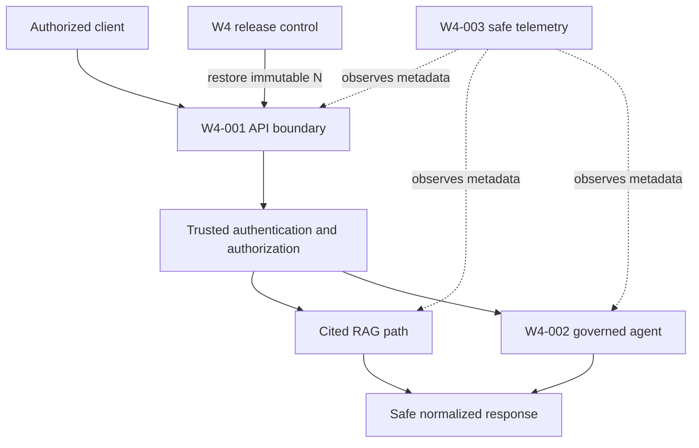

# Week 4 Enterprise AI Platform Implementation Review

## Document status

- Prompt/task: `W4-13`
- Document classification: **Column N closed — final-approved W4-13 learning record**
- Owner teach-back status: **PASS**
- Column N final approval: **FINAL APPROVAL AFTER OWNER TEACH-BACK — APPROVED**
- Final approval time and timezone: **2026-08-31 18:03:21 SGT (UTC+08:00)**
- W4-12 checkpoint: **FINAL WEEK 4 SIGN-OFF — COMPLETED AND APPROVED**
- Week 5 handover: **APPROVED — proceed under the separate Week 5 approval gates**
- Runtime commands or tests executed by this learning task: **None**
- Tracker update responsibility: **Owner**

This document is the owner-approved learning and implementation summary for Week 4. It records the completed local architecture and test evidence. It does not claim cloud deployment, production readiness, a production SLO, live-provider validation or infrastructure rollback.

---

# 1. Business summary

## 1.1 What Week 4 delivered

Week 4 turned the earlier retrieval and cited-RAG components into a controlled, observable and recoverable AI application platform.

The previous weeks established the foundations:

- Week 1 created governance, configuration, feature ownership, test and lifecycle controls.
- Week 2 implemented deterministic embedding, ingestion and authorization-aware retrieval.
- Week 3 implemented cited RAG, deterministic evaluation, guardrails and RAG-configuration rollback.

Week 4 placed an enterprise application boundary around those capabilities:

1. **W4-001 — API and authentication boundary:** Clients can call typed health, query and agent endpoints without directly accessing the retriever, vector store, model or agent internals.
2. **W4-002 — Governed agent workflow:** A bounded LangGraph workflow can reason through approved steps, use a narrow read tool, pause for human approval and safely reject or stop unsafe actions.
3. **W4-003 — Vendor-neutral observability:** Safe metrics, traces and structured logs show which workflow stages ran and how they ended without recording prompts, answers, evidence, credentials or personal data.
4. **W4-09 — Failure testing:** Denial, malformed arguments, injection, timeout, loop and approval-rejection paths were exercised to prove safe termination without write side effects.
5. **W4-10 — Bounded local load testing:** The API was exercised under deterministic concurrency to prove bounded admission, overload handling and latency reporting without presenting the result as a production SLO.
6. **W4-ROLLBACK-001/W4-11 — Immutable release rollback:** A safe faulty candidate release was detected and the exact known-good application release was restored in 838 ms, followed by successful smoke and zero-residue checks.

## 1.2 Business problem solved

An enterprise AI application is not safe merely because it can answer a question. The business needs confidence that:

- Only authenticated and authorized users can reach the AI workflow.
- The client cannot manufacture its own identity or permissions.
- AI responses are normalized and do not expose prompts, evidence or raw exceptions.
- Agent actions remain bounded and require approval where consequences could occur.
- Failures terminate safely instead of looping, retrying indefinitely or executing unauthorized tools.
- Operations teams can understand the path taken without collecting sensitive business content.
- Load is shed predictably before the system becomes unstable.
- A defective release can be rejected and the exact approved version restored quickly.

Week 4 establishes those controls as one connected application platform.

## 1.3 Business value by implementation

| Implementation | Business value |
|---|---|
| W4-001 API boundary | Gives applications a stable, typed interface and prevents clients from coupling directly to internal AI components. |
| W4-001 authentication seam | Ensures identity and authority come from a trusted dependency, not from user-controlled JSON. |
| W4-002 agent | Enables controlled multi-step automation while limiting what the agent may do. |
| Human approval | Preserves human accountability before a proposed write-like action can execute. |
| Budgets and deadlines | Prevent runaway cost, looping workflows and unpredictable response time. |
| Redacted durable state | Supports restart and audit needs without persisting prompts, answers, evidence or secrets. |
| W4-003 telemetry | Gives engineering, SRE, security and audit teams safe operational visibility. |
| W4-09 failure tests | Proves negative paths are designed behavior, not accidental behavior. |
| W4-10 load test | Shows that the local API rejects excess work safely instead of creating an unbounded queue. |
| W4 release rollback | Reduces recovery risk by restoring the exact known-good application rather than editing forward during an incident. |

## 1.4 Stakeholders and benefits

- **Business users:** Receive stable answers, safe abstentions and clear errors rather than inconsistent internal failures.
- **Application teams:** Integrate through typed HTTP contracts instead of depending on RAG, vector-store or model details.
- **Security:** Gains trusted authentication, deny-before-work, redaction and zero-side-effect failure evidence.
- **SRE and operations:** Gain bounded concurrency, deadlines, safe telemetry, failure classifications and rollback evidence.
- **Risk and audit:** Gain deterministic identities, owner approvals, retained historical failures and explicit NOT RUN limitations.
- **Engineering leadership:** Can distinguish local architectural proof from production readiness and plan the later cloud operating model honestly.

## 1.5 Measured Week 4 outcomes

| Stage | Recorded result |
|---|---|
| W4-001 closure | 537 passed, 7 skipped, 4 deselected |
| W4-002 closure | 613 passed, 7 skipped, 4 deselected, 10 subtests |
| W4-003 core observability closure | 679 passed, 7 skipped, 4 deselected, 10 subtests |
| W4-09 and W4-10 closure | 690 passed, 7 skipped, 4 deselected, 10 subtests |
| W4 release rollback closure | 724 passed, 7 skipped, 4 deselected |
| Release rollback | PASS — exact known-good `N` restored in 838 ms |
| Smoke verification | PASS |
| Cleanup | PASS — `ZERO_RESIDUE` |
| Open FAIL | None |
| Open INDETERMINATE | None |
| Accepted warning | Existing Starlette/httpx deprecation warning |

Historical failures remain part of the audit history even though their approved remediation reruns passed.

---

# 2. Technical deep-dive

## 2.1 End-to-end architecture

The Week 4 platform has four cooperating planes:

1. **Business request plane:** HTTP request, authentication, authorization, RAG or agent execution and normalized response.
2. **Control plane:** Feature flags, budgets, human approval, immutable release identity, activation and rollback.
3. **Telemetry plane:** Safe metrics, spans and metadata-only structured logs.
4. **Failure and recovery plane:** Timeouts, overload, denial, safe terminal states, rollback, smoke and cleanup.



Telemetry observes the application but cannot authorize a request, change an answer or cause a retry. Release control restores application identity but does not roll back shared data or infrastructure.

## 2.2 W4-001 — API and authentication boundary

### Purpose

W4-001 created a thin FastAPI adapter over the approved RAG and later agent services. The API owns transport concerns; it does not duplicate RAG, retrieval, authorization or guardrail logic.

### Route model

- `/health` preserves the original health contract.
- `/health/live` proves the application event loop can respond.
- `/health/ready` invokes an injected, local readiness probe under a short deadline.
- `/v1/query` accepts one strict query and invokes `RAGService.answer()` exactly once.
- `/v1/agent` was initially a safe disabled boundary and became usable only after W4-002 supplied the governed controller.

Interactive documentation, OpenAPI exposure and slash redirects are disabled in the bounded route mode to avoid accidental extra surfaces.

### Trusted identity

The request body contains only the user query or the strict agent command. It cannot provide tenant, subject, role, group, clearance, ACL, issuer, audience or trusted request identity.

An injected `Authenticator` creates the existing `AuthContext`. Authentication and authorization complete before RAG, retrieval, provider, graph, approval or tool work. Missing, invalid or forbidden authentication therefore produces zero downstream calls.

### Request validation

The transport boundary:

- Accepts strict `application/json` only.
- Enforces a 131,072-byte raw-body limit before parsing.
- Rejects malformed UTF-8, malformed JSON, duplicate keys and non-finite values.
- Rejects missing, wrong-type or unknown fields.
- Passes the raw logical query to the existing RAG boundary as `text/plain`.
- Preserves the approved 10,000-character logical-input guardrail.

This separation is important: byte-size and JSON validation belong to HTTP transport, while logical query validation belongs to the RAG guardrail.

### Request identity

Every enabled request receives a server-generated UUIDv4 request ID. Inbound request IDs, correlation IDs, forwarded headers and trace context are ignored because they are untrusted. The server request ID may appear in responses, spans and safe logs, but never as a metric label.

### Capacity and deadlines

- Maximum admitted API requests: four.
- Waiting queue: zero.
- Overload behavior: immediate safe 503 response.
- Overall query deadline: 30 seconds.
- Readiness deadline: one second.
- API retry: none.

Capacity is released in `finally` for answer, abstention, failure, timeout and cancellation. Cancellation is propagated rather than converted into a fabricated result.

### Safe response model

The API returns only one of:

- A typed answered result with valid citations and optional normalized usage.
- A typed abstention with an approved reason.
- A single content-free error envelope with a stable safe code.

It never returns prompts, retrieved chunks, raw provider envelopes, chain-of-thought, credentials, PII, internal endpoints or stack traces.

## 2.3 W4-002 — Governed LangGraph agent

### Why an agent needed a separate control boundary

RAG answers a question. An agent can make multiple decisions, call tools, pause for approval and continue later. That creates additional risks: loops, excessive cost, stale approvals, state leakage and unintended actions.

W4-002 therefore added a bounded agent controller rather than extending RAG with hidden orchestration.

### Graph design

The graph contains explicit nodes:

1. `validate_input`
2. `authorize`
3. `retrieve`
4. `grade_evidence`
5. `answer`
6. `propose_tool`
7. `await_human_approval`
8. `execute_tool`
9. `safe_terminal`

Every path must end in a finite result such as answered, denied, rejected, timed out, budget exceeded or safe terminal. There is no implicit open-ended loop.

### Tool boundary

The agent uses a strict allowlist:

- A narrow read-only status tool.
- A deterministic mock write tool used only to prove the approval contract.

Tool name, version, schema and authorization are trusted registry data. The model cannot invent a new tool or redefine its schema. Malformed arguments, unexpected tools and unauthorized operations fail before execution.

### Human approval

A write-like proposal pauses the workflow and creates a durable, redacted approval record. A later owner decision may approve or reject it.

The controller validates:

- Approval identity and expected generation.
- Caller authority.
- Expiry and current status.
- One-time consumption.
- Tool and argument identity.
- Replay and concurrent-decision protection.

No approval, rejection, expired approval or stale approval prevents execution. Approval is atomic and cannot be consumed twice.

### Budgets

The agent has deterministic ceilings:

- Maximum graph steps: 8.
- Maximum tool calls: 1.
- Maximum provider attempts: 1.
- Maximum token budget: 4,096.
- Agent deadline: 25 seconds, nested inside the API's 30-second deadline.
- Concurrent agent runs: one.
- Agent waiting queue: zero.

Budget exhaustion produces a finite safe terminal reason. It does not create another retry or fallback workflow.

### Persistence and redaction

The local persistence boundary uses SQLite for durable approval and redacted workflow state. It persists identifiers, finite decisions, counters, versions and safe outcome metadata—not prompts, answers, retrieved evidence, credentials, PII, tool arguments or tool results.

SQLite is a local proof of the state contract, not a production state-backend recommendation. Temporary test databases, journals, WAL files and locks are removed by cleanliness tests.

### API composition

The existing `/v1/agent` endpoint remains the only external entry. The API authenticates first, then calls the injected agent controller. The agent uses an injected evidence gateway and tool registry. It does not directly reach Qdrant, OpenSearch, Bedrock or a live identity provider in the approved local scope.

## 2.4 W4-003 — Vendor-neutral observability foundation

### Observability objective

W4-003 answers operational questions such as:

- Which safe stages ran?
- Did the request answer, abstain, fail, time out or get denied?
- How long did each stage take?
- How many results, tokens, agent steps or tool calls were used?
- Which request, trace and span belong together?

It deliberately does not answer these questions by recording the user's prompt, generated answer, retrieved evidence or tool content.

### Runtime boundary

The application uses a narrow `TelemetryRuntime` protocol:

- `NullTelemetryRuntime` is the default-off implementation.
- `OpenTelemetryRuntime` is enabled only through explicit local/test composition.
- Business components submit normalized enums, bounded counts, approved versions and safe codes.
- Strict allowlists reject raw request, authentication, RAG, evidence, graph, approval, tool and exception objects before any processor or sink sees them.

Telemetry failure cannot change an answer, abstention, denial, approval, rejection, timeout or tool result.

### Metrics

The approved metric families cover:

- Stage executions.
- Stage duration.
- Token usage.
- Retrieval-result counts.
- Agent step counts.
- Agent tool calls.
- Telemetry export failures.
- Dropped telemetry records.

Metric attributes use finite, allowlisted values such as stage, operation, outcome, terminal reason, safe error code and bounded version. Request, trace, span, tenant, subject, document, chunk, approval and run IDs are prohibited as metric labels to prevent unbounded cardinality and privacy leakage.

### Traces

Manual request instrumentation creates a new local root trace after the server request ID is generated. Inbound `traceparent`, `tracestate`, `baggage`, forwarded headers and correlation identifiers are ignored.

The honest deterministic trace set contains:

1. Query trace: API → authentication → guardrail → retrieval → embedding → vector search → LLM → RAG.
2. Agent-start trace: API → authentication → graph nodes → evidence gateway → approval-required or safe read outcome.
3. Agent-decision trace: API → authentication → approval evaluation → approved/rejected mock tool → safe terminal.

These are three real request traces. A fabricated single trace was rejected because query, agent start and later approval are separate operations.

### Safe logs and bounded storage

Logs contain only schema version, event name, service name, server request ID, trace/span ID, stage, operation, finite outcome, safe reason, duration and bounded numeric counts or versions.

The local test runtime uses:

- Bounded span capacity: 512.
- Bounded safe-log capacity: 512.
- Overflow policy: drop oldest.
- Telemetry queue: zero.
- Retry count: zero.
- Background task/thread: zero.
- File or socket spill: prohibited.

Exporter failure is normalized, counted and isolated. Raw exporter exceptions are not logged.

### Collector configuration

A configuration-only OpenTelemetry Collector contract defines loopback OTLP listeners on `127.0.0.1:4317` and `127.0.0.1:4318`, bounded batch settings and a local debug exporter. The collector was not executed. Runtime/schema compatibility, external exporters, dashboards, alerting and production retention remain later responsibilities.

## 2.5 W4-09 — Failure-mode verification

W4-09 exercises the agent and API's negative paths:

- Authentication and authorization denial.
- Malformed tool arguments.
- Prompt injection.
- Timeout and cancellation.
- Loop or budget exhaustion.
- Human rejection.
- Unexpected or unsafe tool requests.

The important acceptance condition is not merely that an error appears. It is that every path reaches an approved terminal state with no write side effect, no unauthorized downstream call, no sensitive error content and no leftover task or state resource.

## 2.6 W4-10 — Bounded local load and smoke testing

W4-10 uses in-process ASGI requests and deterministic dependencies. It does not start a production service or call a live model.

The approved profile includes:

- Concurrency levels 1, 4 and 8.
- Warm-up requests before measurement.
- 200 measured requests per concurrency level: 600 measured requests in total.
- p50, p95 and p99 reporting.
- Success, safe-error, overload and total-request counts.
- A maximum bounded test duration.
- Redacted deterministic output and zero residue.

The test proves local admission, overload and timing behavior. It does not establish a production SLO, cloud capacity, pod count, autoscaling policy or real-model latency.

## 2.7 W4-ROLLBACK-001/W4-11 — Immutable release rollback

### Difference from W3 rollback

- **W3-004:** Restores an approved RAG configuration.
- **W4-ROLLBACK-001:** Restores the complete approved local application release identity.
- **Infrastructure rollback:** Would restore cloud resources, images, deployments or clusters and was not performed.

### Release N

The known-good release `N` is defined by:

- Version `w4-known-good-v1`.
- A 99-file application/configuration/data/dependency payload.
- Canonical composition SHA-256:

```text
5340439d876036885558c32738416dd908a27f763bd87fc5e43fd1690f08dbdc
```

Release-control tooling is outside this immutable application payload.

### Synthetic N+1

`N+1` uses exactly the same commit and artifact fingerprints as `N`. Its only intentional behavior change is:

```text
agent_enabled = false
regression_profile = w4-011.agent-route-disabled.v1
expected result = HTTP 501 / agent_disabled
```

This is a safe regression because it disables capability instead of permitting unsafe work. The candidate check requires zero RAG, retrieval, provider, graph, approval and tool calls.

### Identity and activation

Release descriptors use canonical UTF-8 JSON, sorted keys and paths, compact separators, one final newline and SHA-256. Missing, additional, reordered, reformatted, traversing, case-ambiguous, symlinked or modified artifacts fail closed.

Activation and rollback use:

- A bounded exclusive-writer lock.
- A one-second acquisition timeout.
- Ten-millisecond monotonic polling.
- Expected-current compare-and-swap.
- Generation recheck.
- Same-directory atomic replacement.
- Post-write identity verification.
- Idempotent already-active behavior.
- No automatic stale-lock deletion.
- No hidden fallback or retry.

### Safety latch

After restoring `N`, the application remains in `RESTORED_PENDING_SMOKE` with `agent_route_allowed=false`. Only a complete successful smoke verification changes it to `VERIFIED` and allows the route.

If rollback or smoke fails, the platform stops, preserves the failed candidate identity, keeps the agent disabled and requires a bounded remediation decision. It never edits the known-good release under pressure.

### Measured result

- Rollback: PASS.
- Exact known-good `N` restored.
- Rollback duration: 838 ms.
- Approved local hard limit: 30,000 ms.
- Smoke: PASS.
- Cleanup: PASS — zero residue.

The 838 ms result is a local deterministic recovery measurement. It is not a production RTO or infrastructure rollback measurement.

## 2.8 Security and privacy controls across Week 4

- Identity is injected by a trusted authenticator.
- Authorization denies before RAG, retrieval, graph or tool work.
- Request JSON cannot manufacture authority.
- Strict schemas reject unknown fields and malformed content.
- Input size, deadlines, concurrency and agent budgets are bounded.
- Tool use is allowlisted and schema-validated.
- Write-like behavior requires durable human approval.
- Persisted agent state is redacted.
- Telemetry accepts only safe normalized metadata.
- Request IDs and trace IDs are excluded from metric labels.
- Prompts, answers, evidence, credentials, PII, tenant IDs, approval IDs, tool arguments/results and raw exceptions are prohibited from telemetry and errors.
- Release identities are immutable and checksum-bound.
- Rollback cannot mutate shared data or infrastructure.

## 2.9 Reliability and failure behavior

| Failure | Safe behavior |
|---|---|
| Missing/invalid authentication | Reject before any AI or tool work. |
| Unauthorized evidence | Safe abstention or denial; no data leakage. |
| Invalid request | Typed 4xx safe error with no raw input reflection. |
| Capacity exhausted | Immediate 503 overload; no waiting queue. |
| API deadline | Safe 504; capacity released. |
| Agent budget exceeded | Finite safe terminal reason. |
| Missing/expired/rejected approval | No tool execution. |
| Telemetry exporter failure | Business result preserved; safe failure counter only. |
| Cancellation | Propagated; no replacement work. |
| Faulty release | Candidate fails the gate; immutable N restored. |
| Rollback verification failure | Agent remains disabled; no automatic fallback or mutation of N. |

## 2.10 What remains intentionally unproven

- Python 3.11 runtime execution for the latest rollback cycle.
- Live authentication or identity-provider integration.
- Live Qdrant/OpenSearch, Bedrock or another model/provider.
- Collector runtime and external telemetry export.
- Production persistence and approval services.
- Container image promotion and registry behavior.
- Kubernetes/EKS deployment and rollback.
- Cloud infrastructure rollback.
- Production latency, throughput, capacity or SLO compliance.
- Production monitoring, dashboards, alerting, retention and on-call integration.

These are honest scope limits, not hidden failures.

---

# 3. Layman analogy

Imagine the Week 4 platform as a secure bank branch.

## W4-001 — The reception desk and security guard

The API is the reception desk. Customers cannot walk directly into the vault, database or manager's office. They must use a standard form.

The authenticator is the security guard. The customer cannot write “I am an administrator” on the form and gain authority. The guard independently verifies who the person is and what they may do.

The desk also limits how many people can be served at once. If all approved counters are busy, a new customer is told to try again instead of being placed into an endless invisible queue.

## W4-002 — The controlled case manager

The agent is a case manager following a fixed checklist. It can inspect approved information and use one approved read-only tool.

If it proposes something with consequences, it prepares a request and waits for a human manager. It cannot approve its own request. An expired, rejected, reused or mismatched approval cannot unlock the action.

The case manager also has a time limit, step limit and action limit. If the case becomes stuck, it stops safely rather than working forever.

## W4-003 — CCTV that records events, not documents

Telemetry is like CCTV and an operations counter that records:

- Which counter was used.
- Whether the request succeeded or was denied.
- How long the step took.
- How many controlled actions occurred.

It does not photograph the customer's documents, password, account information or conversation. If the CCTV system breaks, the bank transaction does not suddenly become approved or rejected differently.

## W4-09 and W4-10 — Emergency drills and crowd tests

W4-09 is a security drill: invalid identity, bad form, suspicious instruction, timeout, repeated loop and rejected approval are tested to ensure no unsafe action occurs.

W4-10 is a controlled crowd test: one, four and eight groups arrive at the branch. The test confirms that the branch serves its approved capacity and safely turns excess demand away instead of allowing uncontrolled crowding.

## W4 rollback — Returning to the exact inspected branch procedure

Release `N` is the signed, inspected branch operating manual. `N+1` is a new manual containing one deliberately safe defect: the agent counter is disabled.

The release gate detects the defect. The rollback process does not rewrite the new manual under pressure. It atomically changes the active reference back to the exact signed `N` manual, checks its identity, runs the branch opening checks and only then re-enables the agent counter.

The local drill restored the known-good manual in 838 ms and left no temporary drill material behind.

---

# 4. Decision recap

| Decision | Selected approach | Rejected or deferred alternative | Reason |
|---|---|---|---|
| API exposure | Thin typed FastAPI adapter | Let clients call RAG/vector/model components directly | Preserves stable contracts and limits coupling. |
| Default behavior | New routes and advanced components default off | Enable everything automatically | Limits blast radius and supports configuration rollback. |
| Identity | Injected trusted `AuthContext` | Identity fields supplied in JSON | Client input cannot be trusted as authority. |
| Request parsing | Bounded streaming body plus strict JSON | Normal framework body binding without a pre-parse byte cap | Prevents parsing abuse and duplicate-key ambiguity. |
| Request identity | Server UUIDv4; ignore inbound IDs | Trust client correlation and forwarded IDs | Prevents spoofing and uncontrolled correlation. |
| Concurrency | Four API admissions, zero queue | Unbounded queue or hidden waiting | Makes overload explicit and bounded. |
| Agent design | Explicit finite LangGraph nodes | Free-form autonomous loop | Supports deterministic safety and testability. |
| Tools | Allowlisted, versioned, strict schemas | Model-selected arbitrary tools | Prevents invented or unauthorized actions. |
| Human approval | Durable, atomic, one-time decision | In-memory or model self-approval | Preserves accountability and replay safety. |
| Agent budgets | Fixed steps, tools, attempts, tokens and deadline | Open-ended reasoning/retries | Controls cost, time and loop risk. |
| State | Redacted SQLite proof | Persist full prompts/evidence or use a live external store | Demonstrates durability without sensitive content or external dependency. |
| Telemetry contract | Vendor-neutral OpenTelemetry API/SDK | CloudWatch/X-Ray or Prometheus/Grafana hard-wiring | Keeps application semantics portable and separates instrumentation from backend choice. |
| Instrumentation | Manual trusted request instrumentation | FastAPI auto-instrumentation | Allows rejection of inbound trace context and exact content controls. |
| Telemetry data | Strict allowlist before buffering/export | Record broadly and redact later | Redaction after collection is too late. |
| Telemetry storage | Bounded 512 spans and 512 logs, drop oldest | Unbounded buffers or background batch workers | Prevents memory growth and hidden lifecycle resources. |
| Trace acceptance | Three genuine request traces | Fabricated single trace across separate operations | Evidence must reflect actual architecture. |
| Load testing | In-process deterministic 600-request profile | Live service or production SLO claim | Proves local contract without network/provider variability. |
| Release identity | Canonical 99-file checksum-bound payload | Mutable tags or current working directory as authority | Exact identity is necessary for reproducible rollback. |
| Safe regression | Disable agent in N+1 | Corrupt citations, authorization or broad API behavior | Disabling capability is safer and easier to verify. |
| Rollback state | Lock, CAS, generation and atomic replace | Direct overwrite or edit-forward | Prevents stale writers and partial activation. |
| Recovery safety | Agent latch stays false until smoke passes | Re-enable immediately after pointer change | Identity restoration alone does not prove feature health. |
| Failure policy | Stop and request bounded remediation | Automatic fallback/retry | Hidden fallback can conceal failed recovery. |

## Decisions to revisit later

The architecture should be reconsidered when moving to production because the operating context changes:

- Replace fake identity with an approved IdP/JWT/JWKS boundary.
- Select a production state and approval service.
- Connect telemetry to an approved collector and backend with retention, residency, TLS and access policies.
- Re-run load tests with real deployment topology and model/provider latency.
- Define production SLIs, SLOs, alerts and error budgets.
- Define immutable image promotion and Kubernetes/EKS rollback.
- Prove infrastructure rollback separately.

---

# 5. Interview Q&A

## Q1. What was the main outcome of Week 4?

**Answer:** Week 4 converted the cited-RAG components into an application platform. We added a typed API and trusted authentication boundary, a bounded LangGraph agent with human approval, vendor-neutral safe telemetry, deterministic failure and load tests, and an immutable release rollback mechanism. The final local suite passed 724 tests, and the known-good application release was restored in 838 ms with successful smoke and zero residue.

## Q2. Why did you create a thin API rather than expose the RAG service directly?

**Answer:** The API owns transport concerns—media type, body size, strict JSON, request IDs, authentication, deadlines, admission control and error normalization. RAG continues to own query validation, retrieval, citation and abstention logic. This separation prevents duplicated policy, protects internal components and gives clients a stable contract.

## Q3. How do you prevent a caller from inventing its own permissions?

**Answer:** The request body cannot contain trusted identity or authorization fields. An injected authenticator creates the existing `AuthContext`, and authorization completes before RAG, retrieval, graph or tool work. Security tests assert zero downstream calls for missing, invalid and forbidden authentication.

## Q4. How does the API protect itself from overload?

**Answer:** It uses an atomic non-waiting limiter with four admitted requests and zero queue. Excess work receives a safe 503 overload response. Admitted requests run under a 30-second deadline, and capacity is released in `finally` for success, abstention, timeout, exception and cancellation. There is no API retry.

## Q5. Why use LangGraph for the agent?

**Answer:** The requirement was a controlled multi-step workflow with explicit states, approvals and terminal outcomes. LangGraph models each node and transition visibly. We used nine explicit nodes, bounded steps and no graph retry policy. A simpler function chain would work for a very small workflow, but the graph makes pauses, approval and terminal-path testing clearer.

## Q6. How is the agent prevented from becoming autonomous or unsafe?

**Answer:** It has a fixed graph, a strict tool allowlist, typed arguments, one tool-call budget, one provider-attempt budget, a token ceiling, a 25-second deadline and a one-run zero-queue limiter. Write-like behavior requires durable external human approval. Every path ends in a finite approved outcome.

## Q7. How does human approval work?

**Answer:** The agent proposes a bounded action and persists a redacted approval record. A later request supplies the human decision. The controller checks caller authority, approval identity, expected generation, expiry, tool identity and prior consumption. The decision is atomic and one-time, so replay, duplicate approval or concurrent consumption cannot execute the tool twice.

## Q8. What is persisted in agent state?

**Answer:** Only safe metadata such as identifiers, finite outcomes, versions, counters and approval decisions. Prompts, answers, retrieved evidence, credentials, PII, tool arguments and tool results are excluded. SQLite proves the local durability contract; it is not presented as the final production backend.

## Q9. Why is telemetry vendor-neutral?

**Answer:** Application components should emit stable operational signals without depending on CloudWatch, X-Ray, Prometheus, Grafana or another backend. OpenTelemetry provides that application contract. A future platform team can select exporters and storage without changing business logic, subject to separate security, retention and cost approval.

## Q10. How do you stop sensitive content from entering telemetry?

**Answer:** Redaction occurs before the OpenTelemetry SDK, processor, buffer, log sink or exporter. Components can submit only strict normalized attributes from allowlisted enums, counts, safe codes and bounded versions. Raw request, authentication, RAG, evidence, graph, tool and exception objects are rejected by type and schema validation.

## Q11. How do you control telemetry cardinality?

**Answer:** Metric labels are limited to finite fields such as stage, operation, outcome, terminal reason, safe error code and approved versions. Request, trace, tenant, subject, document, chunk, approval and run IDs are forbidden as metric attributes. Request and trace IDs are permitted only in traces and safe logs.

## Q12. What happens if telemetry fails?

**Answer:** The failure is normalized and counted, but the business result is preserved. Telemetry cannot turn a denial into approval, fail a valid answer, retry a provider or execute a tool. The local runtime has zero retry, zero background workers, bounded buffers and no disk or socket spill.

## Q13. Why are there three W4-08 traces rather than one end-to-end trace?

**Answer:** Query, agent start and human approval decision are three genuine requests. A single trace covering all stages would be fabricated unless a real distributed parent existed. We chose honest evidence: one trace per request scenario, with the three-trace set collectively covering API, auth, RAG, graph, approval and tool stages.

## Q14. What did W4-09 prove?

**Answer:** It proved that denial, malformed tool arguments, injection, timeout, loop/budget exhaustion and human rejection all terminate safely. The key evidence is not merely an error response; it is zero unauthorized write side effects, zero sensitive output and correct terminal-state classification.

## Q15. What did W4-10 prove, and what did it not prove?

**Answer:** It proved deterministic local admission, overload and latency-reporting behavior using in-process ASGI and fake dependencies across concurrency 1, 4 and 8 with 600 measured requests. It did not prove production capacity, real-model latency, Kubernetes scaling or a production SLO.

## Q16. What is the difference between W3 and W4 rollback?

**Answer:** W3 rollback restores an approved RAG configuration—retrieval, prompt and generation behavior. W4 rollback restores the complete local application release identity containing the API, agent, RAG, evaluation, guardrail and telemetry contracts. Neither exercise rolls back infrastructure or business data.

## Q17. How do you define an immutable release?

**Answer:** The release is a canonical descriptor containing exact repository identity, package version, runtime profile and a sorted 99-file artifact set with SHA-256 fingerprints. The stored JSON must be byte-identical to canonical serialization. Mutable tags or directory names are not authority.

## Q18. Why was `agent_disabled` chosen as the synthetic regression?

**Answer:** It is deterministic and fail-safe. It removes a capability instead of permitting unsafe behavior. The gate expects HTTP 501 and safe code `agent_disabled` with zero downstream calls. A citation or authorization defect would exercise more logic but would create greater ambiguity and safety risk.

## Q19. How is rollback made concurrency-safe?

**Answer:** It uses a bounded exclusive lock, expected-current compare-and-swap, generation recheck, same-directory atomic replacement and post-write identity validation. Stale locks are not deleted automatically, and already-active rollback is idempotent. These controls prevent stale writers and partial state publication.

## Q20. Why does the agent stay disabled after N is restored?

**Answer:** Restoring the correct identity is necessary but not sufficient. The system enters `RESTORED_PENDING_SMOKE` and keeps `agent_route_allowed=false`. Only after health, routes and protected feature gates pass does the state become verified and the route become allowable.

## Q21. Is 838 ms the production rollback RTO?

**Answer:** No. It is the measured local deterministic application-identity restoration time and is below the approved local 30-second gate. Production RTO must include image distribution, orchestration, readiness, traffic shifting, dependencies and real infrastructure behavior, none of which were exercised.

## Q22. How did you preserve audit truth after test failures?

**Answer:** Historical failures were never deleted or relabelled. Each remained recorded with its cause, bounded owner-approved remediation and successful rerun. Final PASS means the current approved implementation passed; it does not mean no failure occurred during development.

## Q23. What would you change for production?

**Answer:** I would retain the same contracts but replace local fakes with approved identity, provider, vector, persistence, approval and telemetry integrations. I would build immutable images, deploy through gated Kubernetes/EKS promotion, define production SLIs/SLOs and alerts, run realistic load and failure tests, and prove image and infrastructure rollback separately.

## Q24. What is the strongest architecture decision in Week 4?

**Answer:** The strongest decision is separation of concerns with fail-closed boundaries. The API cannot manufacture identity, the agent cannot invent tools or self-approve, telemetry cannot see business content or alter outcomes, and release rollback cannot rewrite the known-good release. Each plane has a narrow contract and independent failure behavior.

## Q25. How would you summarize Week 4 in two minutes?

**Answer:**

Week 4 turned our cited-RAG components into a governed AI application platform. First, we built a thin FastAPI boundary with strict JSON and size validation, server-generated request IDs, trusted injected authentication, four-request admission control, zero queue and normalized responses. Authorization completes before any retrieval, model or tool work.

Second, we added a bounded LangGraph agent with explicit nodes and terminal outcomes. It has fixed step, tool, provider, token and time budgets. Tools are allowlisted, and a write-like mock action requires durable, atomic human approval. Persisted state contains only redacted metadata.

Third, we implemented vendor-neutral OpenTelemetry instrumentation. Metrics, traces and safe logs accept only allowlisted metadata; they never receive prompts, evidence, PII, credentials or tool content. Export failure cannot affect the business result. We then exercised agent failure modes and a bounded 600-request local load profile.

Finally, we proved immutable application-release rollback. A safe N+1 candidate disabled the agent and correctly failed with `agent_disabled`. The control plane restored the exact checksum-bound known-good N using locking, compare-and-swap and atomic replacement. Restoration took 838 ms, smoke passed and cleanup left zero residue. The final suite passed 724 tests. This is strong local architecture evidence, while live identity, providers, cloud deployment, production SLOs and infrastructure rollback remain explicitly unproven.

---

# 6. Owner approval

## Owner-approved statement

I, **Gyan Prakash Rai**, approve this document as the accurate business, technical, learning and interview summary of the completed Week 4 local implementation and owner-test evidence.

This approval confirms:

- W4-001 API and authorization implementation is represented accurately.
- W4-002 agent, tools, human approval, budgets and redacted-state implementation is represented accurately.
- W4-003 telemetry and trace-correlation implementation is represented accurately.
- W4-09 failure testing and W4-10 bounded local load testing are represented accurately.
- W4-ROLLBACK-001 local immutable application-release rollback is represented accurately.
- The recorded test progression, 838 ms rollback, smoke PASS and zero-residue result are preserved.
- Historical failures, skips, deselections, warnings, limitations and NOT RUN activities remain visible.
- No production, live-provider, cloud, infrastructure-rollback or production-SLO claim is made.

Approval status: **OWNER APPROVED**

Approval timestamp: **2026-08-31 18:03:21 SGT (UTC+08:00)**

The separate W4-12 checkpoint is completed and approved in `docs/deployment-records/W4-signoff.md` at the same owner-supplied timestamp. The Week 4 learning record, documentation review and sign-off are complete. No unresolved Week 4 documentation, approval, learning or sign-off item blocks Week 5 work.

Week 5 may proceed under its own four approval gates plus owner testing and learning. This approval does not authorize production deployment, external services, cloud activity, Excel changes or Git mutation, and it does not convert any recorded NOT RUN activity into PASS.

**FINAL APPROVAL — WEEK 4 LEARNING CLOSED — W4-13.**
